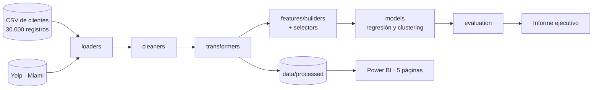

<p align="center"></p>

<h1 align="center">Cliente360</h1>

<p align="center"><b>Data cleaning, segmentation and models to understand customers and market opportunities.</b></p>

<p align="center"></p>

<p align="center">
    
</p>

<p align="center"><a href="https://dodysalim.github.io/"><b>🌐 Portfolio</b></a> · <a href="README.md"><b>🇪🇸 Versión en español</b></a></p>

---

## 📌 At a glance

| | |
| --- | --- |
| **🎯 Problem** | Identify customer profiles and what conclusions the data coverage really supports. |
| **🛠️ Solution** | Staged ETL pipeline, feature engineering, regression and clustering. |
| **📈 Deliverables** | Executive report and a 5-page Power BI dashboard. |
| **🧪 Quality** | 7 automated tests, including the Yelp loader fixed in v1.1.0. |

## 🏗️ Architecture



## 🚀 How to run

```bash
python -m venv .venv && source .venv/bin/activate
pip install -r requirements-dev.txt
python scripts/run_etl.py --no-save
python -m pytest tests -q
```

## ⚖️ Scope

Training data; no realized business impact is claimed. Yelp coverage is Miami only (200 unique venues).

---

<p align="center">
<b>Dody Dueñas Remache</b> · Data Analyst / Data Scientist · Guayaquil, Ecuador (remote LATAM)<br>
<a href="https://dodysalim.github.io/">Portfolio</a> · <a href="https://github.com/dodysalim">GitHub</a> · <a href="https://www.linkedin.com/in/dody-duenas/">LinkedIn</a> · <a href="mailto:dodydurema67@gmail.com">dodydurema67@gmail.com</a>
</p>
